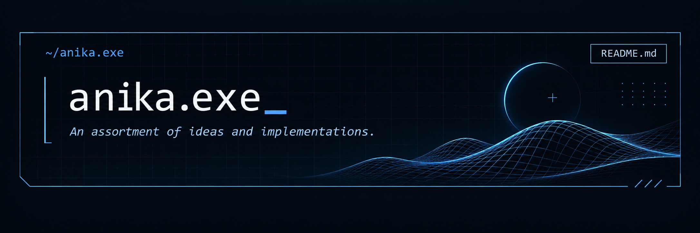
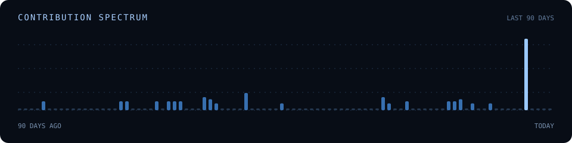

  

 

<a href="#01--context">01 / Context</a>
&nbsp;&nbsp; / &nbsp;&nbsp;
<a href="#02--selected-work">02 / Selected Work</a>
&nbsp;&nbsp; / &nbsp;&nbsp;

---

### 01 - Context

Hi, I'm Anika.

I have a background in Computer Science, although I've never been particularly good at keeping my interests confined to one subject.

I've spent time working on software development and AI-integrated applications, but I've always been equally interested in the creative side of building things. I enjoy turning abstract ideas into something tangible, whether that involves writing code, experimenting with interfaces, or figuring out how different pieces fit together.

I'm particularly drawn to the space between design and engineering, where functionality and creativity have to make sense together. I like understanding why things work the way they do, questioning design decisions, and occasionally spending far too long on problems that were supposed to be straightforward.

I wouldn't say I've figured out exactly where my interests will take me, and I'm in no particular hurry to narrow them down.

---

### 02 - Selected Work

#### KothaAI
**AI-powered reflection and mental wellness**

A bilingual web application combining conversational AI, mood tracking, and future letters, designed to make personal reflection more accessible.

`Next.js` · `TypeScript` · `MongoDB` · `Auth.js` · `Groq`

---

#### [MoonBrew Café](https://github.com/anikaexe/MoonBrew-Cafe-)
**Interface experiment**

An exploration of front-end development and visual design.

---

### 03 — Development Footprint

A visual record of activity, not a measure of progress.

#### [2D Car Racing Game](https://github.com/anikaexe/2D-CarRacingGame)
**Interactive game development**

A small game development project exploring interactive gameplay and graphics.

---

<b>More experiments</b>

 

- [Snake Game](https://github.com/anikaexe/snakeGame)
- [OpenGL Snake](https://github.com/anikaexe/snake--game--opengl)
- [Dice Game](https://github.com/anikaexe/DiceGame)

  Still exploring. Occasionally overengineering.

